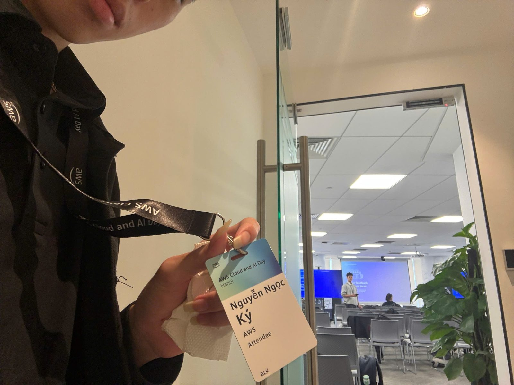

# Summary Report: "AWS Cloud and AI Day Hanoi - Watch Party: Ho Chi Minh City"

**Event name:** AWS Cloud and AI Day Hanoi - Watch Party: Ho Chi Minh City

**Time:** 09:00, 29/09/2026

**Location:** 26th Floor, Bitexco Financial Tower, 2 Hai Trieu Street, Sai Gon Ward, Ho Chi Minh City

**Role:** Attendee

### Event Objectives
- Follow AWS Cloud and AI Day Hanoi, a one-day AWS event on cloud and AI, from the Ho Chi Minh City watch party.
- Catch up on AWS directions in agentic AI, data analytics, cloud migration and modern application development.
- Meet and network with the FCAJ community in Ho Chi Minh City.

### Speakers
- Keynote speakers of the main event in Hanoi (per the AWS event page):
- Dr. Werner Vogels - CTO, Amazon.com
- Eric Yeo - Country General Manager Malaysia, Vietnam, Indochina, AWS
- Mai Le - Director of Product Management, Katalon
- Dr. Jens Lottner - Chief Executive Officer, Techcombank
- Guests: H.E. Hoang Minh (Deputy Minister of Science and Technology) and H.E. Jennifer Wicks (U.S. Ambassador to Vietnam)

### Key Highlights
- The main event ran as a free one-day program with a keynote at 09:00, 30+ sessions, an expo and a startup zone.
- Main themes: agentic AI, data and analytics, cloud migration, industry solutions and modern application development.
- The watch party let FCAJ members follow the program together in Ho Chi Minh City and receive an official attendee badge.

### What I Learned
- AI is moving from single models to agentic AI that can plan and act, and AWS is building services around that direction.
- The cloud foundations from my worklog (compute, storage, networking, security) are what AI applications run on.
- Talking with the community helped me see real career paths in cloud and AI.

### Application to Work
- Use the AI and cloud directions from the event to choose topics for my project and workshop.
- Keep building skills on AWS AI services such as Amazon Bedrock after the analytics and AI weeks.
