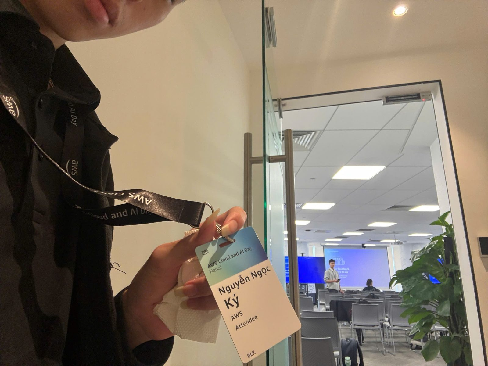

# Báo cáo tóm tắt: "AWS Cloud and AI Day Hanoi - Watch Party: Ho Chi Minh City"

**Tên sự kiện:** AWS Cloud and AI Day Hanoi - Watch Party: Ho Chi Minh City

**Thời gian:** 09:00, 29/09/2026

**Địa điểm:** Tầng 26, tòa nhà Bitexco, số 02 đường Hải Triều, phường Sài Gòn, thành phố Hồ Chí Minh

**Vai trò tham gia:** Người tham dự

### Mục đích sự kiện
- Theo dõi AWS Cloud and AI Day Hanoi, sự kiện một ngày của AWS về điện toán đám mây và AI, tại điểm cầu Watch Party TP.HCM.
- Cập nhật định hướng của AWS về agentic AI, phân tích dữ liệu, di chuyển lên cloud và phát triển ứng dụng hiện đại.
- Gặp gỡ và kết nối với cộng đồng FCAJ tại TP.HCM.

### Diễn giả
- Các diễn giả keynote của sự kiện chính tại Hà Nội (theo trang sự kiện của AWS):
- Dr. Werner Vogels - CTO, Amazon.com
- Eric Yeo - Tổng Giám đốc quốc gia Malaysia, Việt Nam, Đông Dương, AWS
- Mai Le - Giám đốc Quản lý sản phẩm, Katalon
- Dr. Jens Lottner - Tổng Giám đốc, Techcombank
- Khách mời: Ông Hoàng Minh (Thứ trưởng Bộ Khoa học và Công nghệ) và bà Jennifer Wicks (Đại sứ Hoa Kỳ tại Việt Nam)

### Những điểm nổi bật
- Sự kiện chính là chương trình miễn phí kéo dài một ngày, khai mạc bằng keynote lúc 09:00, có hơn 30 phiên, khu expo và khu startup.
- Các chủ đề chính: agentic AI, dữ liệu và phân tích, di chuyển lên cloud, giải pháp theo ngành và phát triển ứng dụng hiện đại.
- Watch Party giúp các thành viên FCAJ cùng theo dõi chương trình tại TP.HCM và nhận thẻ tham dự chính thức.

### Những gì học được
- AI đang chuyển từ các mô hình đơn lẻ sang agentic AI có thể tự lập kế hoạch và hành động; AWS đang xây dựng dịch vụ theo hướng này.
- Nền tảng cloud trong worklog của mình (compute, storage, networking, security) chính là nơi các ứng dụng AI vận hành.
- Trò chuyện với cộng đồng giúp mình thấy rõ hơn các hướng nghề nghiệp về cloud và AI.

### Ứng dụng vào công việc
- Dùng các định hướng AI và cloud từ sự kiện để chọn chủ đề cho dự án và workshop của mình.
- Tiếp tục rèn kỹ năng với các dịch vụ AI của AWS như Amazon Bedrock sau các tuần học về analytics và AI.
