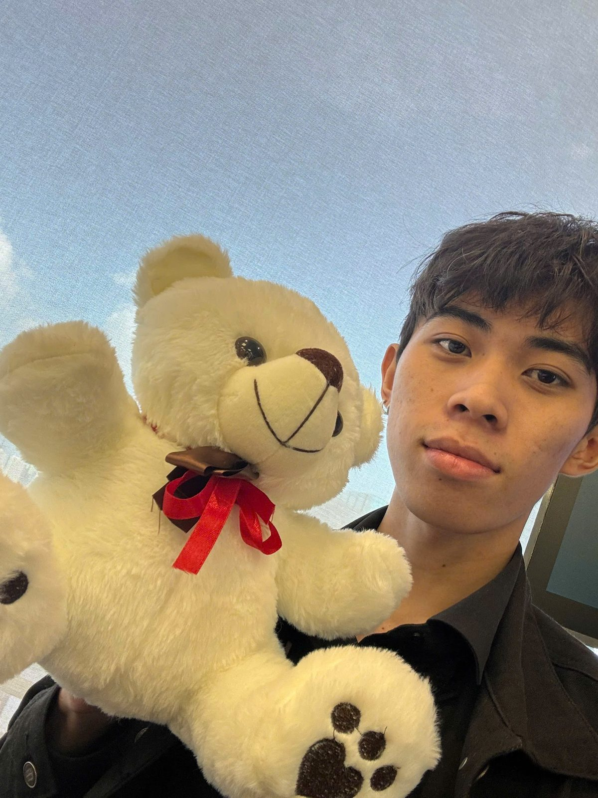

# Summary Report: "Smart Plushies for Children"

**Event name:** Smart Plushies for Children

**Time:** 09:00, 26/10/2026

**Location:** 36th Floor, Bitexco Financial Tower, 2 Hai Trieu Street, Sai Gon Ward, Ho Chi Minh City

**Role:** Attendee

### Event Objectives
- Learn about the idea of smart plushies for children, which combine toys with technology such as IoT, AI and cloud.
- See how cloud services can support a real product aimed at children.
- Practice asking questions and exchanging ideas with the presenters and other attendees.

### Key Highlights
- The event was held on the 36th floor of Bitexco Financial Tower.

### What I Learned
- Products for children need extra attention to safety and to the privacy of children's data.
- A product idea becomes real when hardware, software and cloud services are designed together.
- Hearing how a team explains a product helped me improve how I present my own project.

### Application to Work
- Apply the same thinking to my project: protect user data with IAM, KMS and encryption.
- Present my workshop with a clear problem, solution and demo.
