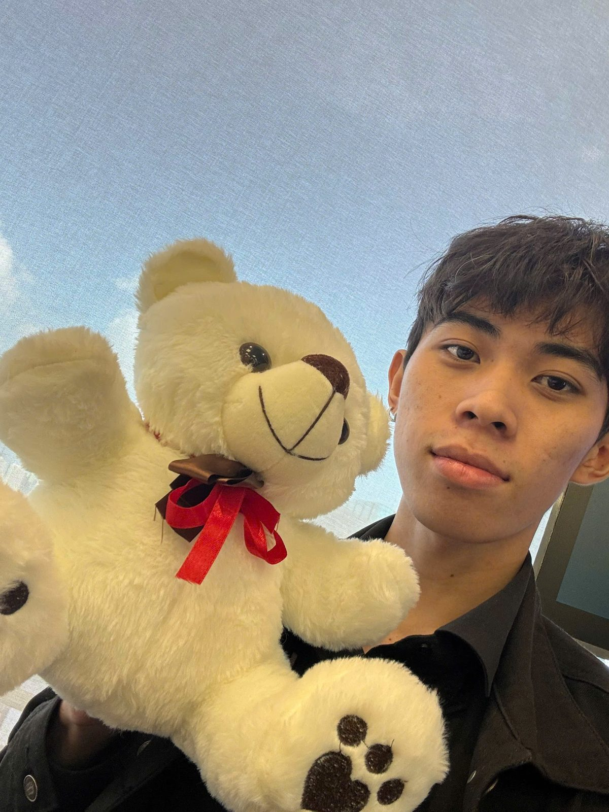

# Báo cáo tóm tắt: "Smart Plushies for Children"

**Tên sự kiện:** Smart Plushies for Children

**Thời gian:** 09:00, 26/10/2026

**Địa điểm:** Tầng 36, tòa nhà Bitexco, số 02 đường Hải Triều, phường Sài Gòn, thành phố Hồ Chí Minh

**Vai trò tham gia:** Người tham dự

### Mục đích sự kiện
- Tìm hiểu ý tưởng thú bông thông minh cho trẻ em, kết hợp đồ chơi với các công nghệ như IoT, AI và cloud.
- Xem cách các dịch vụ cloud hỗ trợ một sản phẩm thực tế dành cho trẻ em.
- Rèn kỹ năng đặt câu hỏi và trao đổi ý tưởng với người trình bày và các bạn tham dự.

### Diễn giả
- [Bổ sung tên và vai trò của diễn giả]

### Những điểm nổi bật
- [Bổ sung các ý chính của phần trình bày hoặc demo]
- Sự kiện diễn ra tại tầng 36 tòa nhà Bitexco.

### Những gì học được
- Sản phẩm dành cho trẻ em cần đặc biệt chú ý đến an toàn và quyền riêng tư dữ liệu của trẻ.
- Một ý tưởng sản phẩm trở thành hiện thực khi phần cứng, phần mềm và dịch vụ cloud được thiết kế cùng nhau.
- Quan sát cách nhóm trình bày sản phẩm giúp mình cải thiện cách trình bày dự án của chính mình.

### Ứng dụng vào công việc
- Áp dụng cách nghĩ này cho dự án của mình: bảo vệ dữ liệu người dùng bằng IAM, KMS và mã hóa.
- Trình bày workshop với vấn đề, giải pháp và demo rõ ràng.
