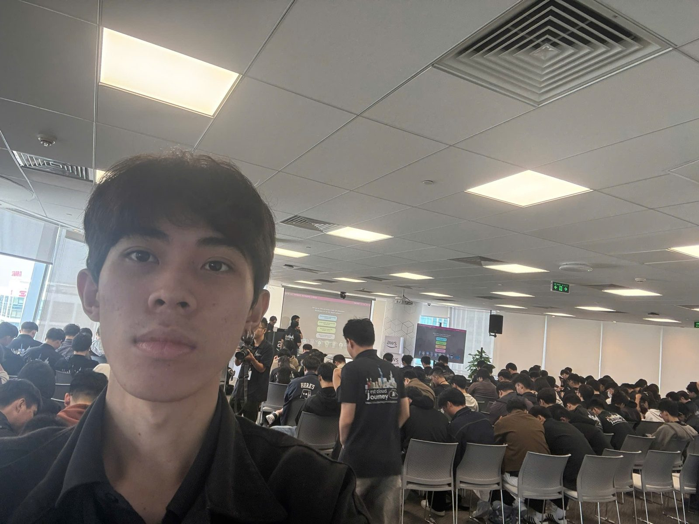

# Summary Report: "FCAJ x FPTU: Cloud Mastery 1"

**Event name:** FCAJ x FPTU: Cloud Mastery 1

**Time:** 09:00, 14/11/2026

**Location:** 26th Floor, Bitexco Financial Tower, 2 Hai Trieu Street, Sai Gon Ward, Ho Chi Minh City

**Role:** Attendee

### Event Objectives
- Learn cloud and AI knowledge in the Cloud Mastery series organized by FCAJ together with FPT University.
- Review the AWS services studied during the internship through hands-on and interactive activities.
- Connect with FCAJ mentors and other FPTU interns.

### Key Highlights
- The hall was full of FCAJ interns, and the program includes a quiz to review knowledge.

### What I Learned
- Interactive quizzes are a good way to find gaps in my AWS knowledge.
- Learning together with the community is faster than studying alone.
- The services from my worklog link together in real AI and cloud solutions.

### Application to Work
- Review the topics where I answered unsure and add them to my study plan.
- Use the Cloud Mastery content as a base for my workshop.
