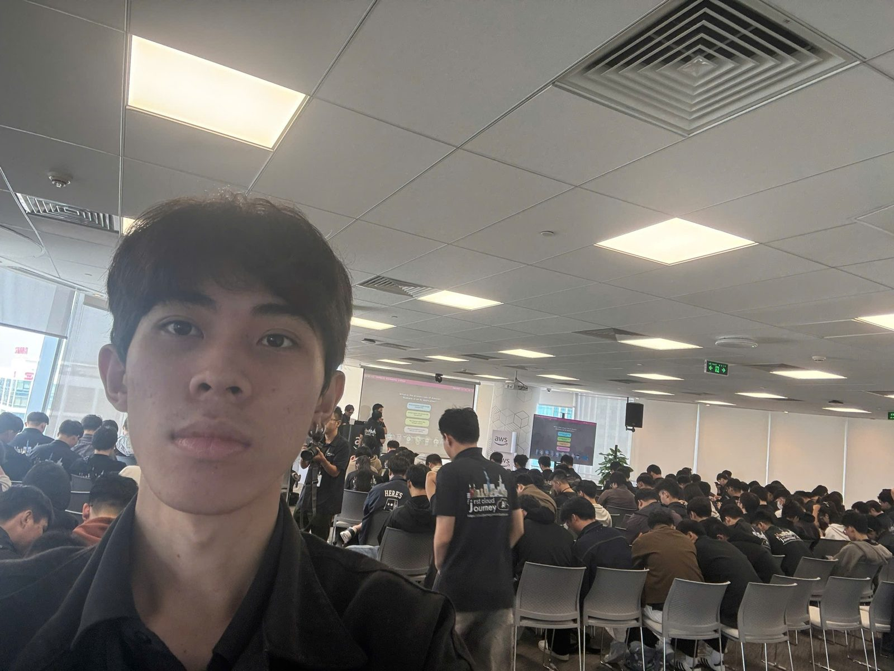

# Báo cáo tóm tắt: "FCAJ x FPTU: Cloud Mastery 1"

**Tên sự kiện:** FCAJ x FPTU: Cloud Mastery 1

**Thời gian:** 09:00, 14/11/2026

**Địa điểm:** Tầng 26, tòa nhà Bitexco, số 02 đường Hải Triều, phường Sài Gòn, thành phố Hồ Chí Minh

**Vai trò tham gia:** Người tham dự

### Mục đích sự kiện
- Học kiến thức cloud và AI trong chuỗi Cloud Mastery do FCAJ phối hợp với Đại học FPT tổ chức.
- Củng cố các dịch vụ AWS đã học trong kỳ thực tập qua hoạt động thực hành và tương tác.
- Kết nối với các mentor FCAJ và các bạn thực tập sinh FPTU.

### Diễn giả
- [Bổ sung tên và vai trò của diễn giả]

### Những điểm nổi bật
- [Bổ sung các phiên và chủ đề chính]
- Hội trường đông thực tập sinh FCAJ, chương trình có phần quiz tương tác trình chiếu trên màn hình.

### Những gì học được
- Quiz tương tác là cách tốt để phát hiện lỗ hổng kiến thức AWS của bản thân.
- Học cùng cộng đồng nhanh hơn tự học một mình.
- Các dịch vụ trong worklog của mình liên kết với nhau trong các giải pháp cloud và AI thực tế.

### Ứng dụng vào công việc
- Ôn lại các chủ đề mình còn chưa chắc và đưa vào kế hoạch học.
- Dùng nội dung Cloud Mastery làm nền tảng cho workshop của mình.
